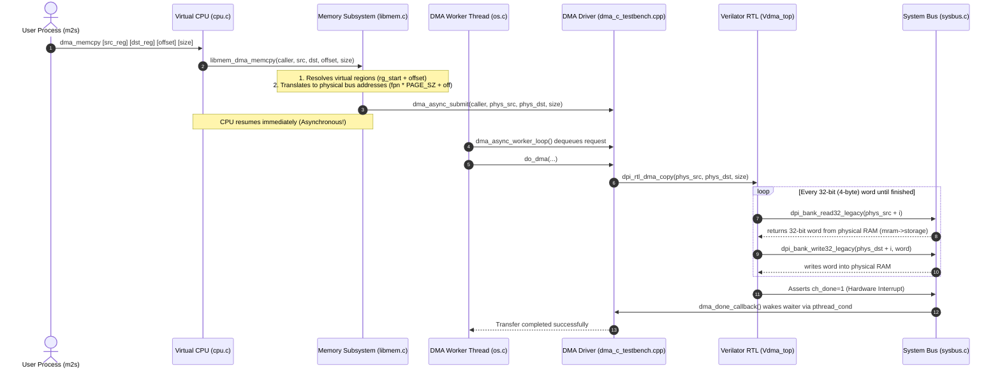

# Team Walkthrough: Direct Memory Access (DMA) & Asynchronous Co-Processor
> **CO2018 Operating Systems Assignment (HK261) — Module 2.3 (Sections 2.3.1 & 2.3.2)**  
> **Author / Maintainer:** DMA Subsystem Lead  
> **Target Audience:** Group Members (Scheduler & Memory Management Leads)

---

## 1. Overview & Objectives

In modern computer architectures, data transfers between memory regions or I/O devices can severely degrade CPU performance if handled via **Programmed I/O** (where the CPU manually reads every byte into a register and writes it out).

To address this, our operating system integrates a hardware **DMA (Direct Memory Access) Co-Processor**:
1. **Asynchronous Operation (Section 2.3.1):** When a process requests a memory copy, the CPU offloads the descriptor (source, destination, size) to the DMA co-processor and immediately resumes executing code without stalling.
2. **Bus Addressing & Co-Processor Access (Section 2.3.2):** The DMA hardware directly arbitrates and accesses physical RAM over the **System Bus** using physical addresses.
3. **Interrupt-Driven Completion:** Once the hardware transfer finishes, the DMA controller asserts `ch_done`, triggering an interrupt callback (`dma_done_callback`) that notifies the operating system.

The hardware controller is implemented as a Verilog RTL module pre-compiled into C++ via **Verilator** (`Vdma_top`). Our implementation bridges the OS software stack with this hardware model.

---

## 2. End-to-End Execution Flow

When a process executes the `dma_memcpy` instruction (e.g., from `input/proc/m2s`), here is the exact path through our codebase:



---

## 3. Detailed Walkthrough of Modified Files

The DMA subsystem spans **4 core files** (plus headers). Here is what each file does:

### A. `src/sysbus.c` & `include/sysbus.h` (System Bus & DPI Callbacks)
- **Role:** Emulates the hardware system bus and interfaces with the Verilator RTL DPI callbacks.
- **Key Functions Implemented:**
  - `sysbus_set_os_memory(void* ptr, size_t size_bytes)`: Allows `os.c` to bind the OS physical memory (`mram.storage`) directly to the system bus on system startup.
  - `memory_bank_get_ptr(uint64_t offset)`: Translates a 64-bit physical bus offset into a direct pointer inside `krnl->mram->storage` (with strict bounds checking).
  - `dpi_bank_read32_legacy(long long offset)` & `dpi_bank_write32_legacy(long long offset, int value)`: DPI callbacks called directly by the Verilog RTL clock-by-clock to read and write 32-bit words across the bus.
  - `dma_done_callback()`: Invoked automatically by the RTL on the rising clock edge when `ch_done` goes high. Uses a `pthread_mutex_t` and `pthread_cond_t` (`g_dma_done_cond`) to implement real interrupt-driven completion synchronization.

### B. `src/dma_c_testbench.cpp` & `include/dma.h` (DMA Driver & Async Worker Queue)
- **Role:** Provides both the standalone testbench driver (`DMA_MAIN=1`) and the OS co-processor driver (`DMA_MAIN=0`).
- **Key Functions Implemented:**
  - `dma_async_submit(...)`: Thread-safe producer function that queues DMA transfer descriptors (`source`, `destination`, `length`) onto `g_dma_q_head` and signals the condition variable.
  - `dma_async_worker_loop()`: Consumer loop executed by the background co-processor thread. Sleeps when idle, wakes on incoming requests, and calls `do_dma()`.
  - `do_dma(...)`: Hardware driver that acquires `g_dma_hw_lock`, resets the interrupt flag (`dma_reset_done()`), calls `dpi_rtl_dma_copy()`, and validates the completion interrupt.
  - `dpi_dma_copy(...)`: Configures the bus mapping for either standalone memory banks or full OS RAM. Guarded testbench dumps with `#if DMA_MAIN == 1` to ensure real process memory is never overwritten during `./os` execution.

### C. `src/os.c` (Co-Processor Thread & Initialization)
- **Role:** Manages system startup, physical RAM allocation, and the co-processor thread lifecycle.
- **Key Functions Implemented:**
  - `co_processor(void *arg)`: Initialized as a dedicated `pthread` in `main()`. Initializes the Verilator simulation via `rtl_dma_init_simulation()` and runs `dma_async_worker_loop()` in the background.
  - `main()` physical bus binding: Immediately after `init_memphy(&mram, memramsz, rdmflag);`, calls `sysbus_set_os_memory(mram.storage, memramsz);` so hardware can access RAM from cycle 0.
  - Clean shutdown: When CPUs and loader finish, signals `dma_async_shutdown()`, joins `pthread_join(*dma, NULL)`, frees resources, and calls `rtl_dma_cleanup_simulation()`.

### D. `src/libmem.c` (Instruction Handler & Address Translation)
- **Role:** Handles the process-level `dma_memcpy` instruction.
- **Key Functions Implemented:**
  - `libmem_dma_memcpy(caller, src, dst, offset, size)`:
    1. Looks up `src` and `dst` region IDs in both the process user symbol table (`caller->mm->symrgtbl`) and kernel symbol table (`caller->krnl->mm->symrgtbl`).
    2. Calculates virtual addresses: `vaddr = rg_start + offset`.
    3. Translates virtual addresses to **physical bus addresses** (`bus_addr = (fpn * PAGE_SIZE) + page_offset`) using `pg_getpage()` (or direct offset fallback if paging is disabled).
    4. Submits the physical transfer to the co-processor queue via `dma_async_submit()`, allowing the calling CPU thread to continue immediately.

---

## 4. How to Test & Verify

### 1. Standalone DMA Hardware Test (Isolated Testbench)
You can test the DMA controller and system bus without running the full OS (no scheduler or paging required):

```bash
cd hk261_ossim_demacOprx
make dma
./dma_testbench 0x1000 0x2000 64
```

**Expected Behavior:**
- Initializes 1 MB system bus memory bank.
- Spawns the Verilator RTL chip (`Initialized dma_rtl simulation`).
- Populates source memory with test pattern `0x01, 0x02, ...` while destination memory is `0x00`.
- Executes RTL DMA transfer across the bus.
- Asserts `dma_done_callback()` ("DMA completed").
- Displays destination memory updated to `0x01, 0x02, ...` matching the source.
- Emits waveform trace to `rtl_trace.vcd` (can be inspected with GTKWave).

### 2. Full OS Simulation
Once Scheduler and Memory Management modules are ready, the test case that exercises DMA is **`input/proc/m2s`**:

```bash
make all
./os os_2_mlq_paging
# or single CPU:
./os os_2_singleCPU_mlq_paging
```

Compare output against `output/os_2_mlq_paging.output` to verify cycle-accurate process execution and co-processor initialization.

---

## 5. Notes for Teammates (How Your Modules Connect with DMA)

1. **For the Scheduler Team (`queue.c`, `sched.c`):**
   - Processes that contain `dma_memcpy` (such as `m2s`) must be dispatched to a CPU by `get_mlq_proc()`.
   - Because DMA transfers are asynchronous, a process executing `dma_memcpy` completes its instruction in 1 CPU cycle and can continue to its next instruction (e.g., `copy_from_user` or `calc`).
2. **For the Memory Management Team (`mm64.c`, `mm-vm.c`):**
   - The DMA hardware bypasses the MMU and operates strictly on **physical memory bus addresses**.
   - `libmem_dma_memcpy()` calls `pg_getpage()` to retrieve the physical Frame Page Number (`fpn`). Ensure `pg_getpage()` correctly marks pages present in `mram` before transfers take place.
