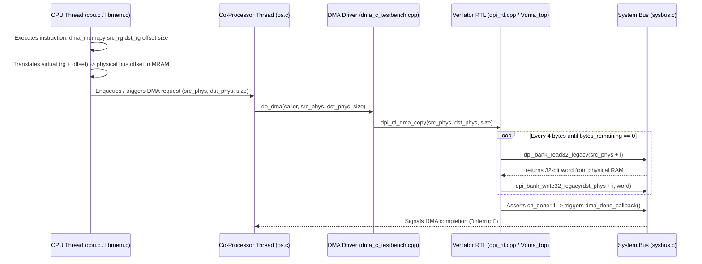

# Guide for Sections 2.3.1 & 2.3.2: Asynchronous Operation, Bus Addressing & DMA Co-Processor

This guide walks you through everything needed to understand and implement **Section 2.3.1 (Asynchronous operation and bus address)** and **Section 2.3.2 (Direct Memory Access - DMA)** in `hk261_ossim_demacOprx`.

---

## 1. How the DMA Hardware Simulation Works Under the Hood

The project includes a pre-verilated SystemVerilog RTL model of a DMA controller (`Vdma_top`). Here is the exact hardware/software call chain:



### Key Facts from the Verilator RTL (`Vdma_top`):
1. **Inputs (`dpi_rtl.cpp`)**:
   - `top->desc_data_0 = source` (64-bit source **bus offset**)
   - `top->desc_data_1 = destination` (64-bit destination **bus offset**)
   - `top->desc_data_2 = length` (32-bit byte count)
   - `top->desc_valid = 1`, `top->ch_enable = 1`, `top->ch_pause = 0`
2. **Bus Transfers (`sysbus.c`)**:
   - The RTL transfers 4 bytes (32 bits) at a time by calling DPI-C imports:
     - `int dpi_bank_read32_legacy(long long offset)`
     - `int dpi_bank_write32_legacy(long long offset, int value)`
   - After each 32-bit write, the RTL increments `src_addr += 4` and `dst_addr += 4`.
3. **Completion Interrupt (`sysbus.c`)**:
   - When `bytes_remaining == 0`, the RTL asserts `ch_done = 1` and automatically invokes the DPI callback `void dma_done_callback(void)` on the next rising clock edge.

---

## 2. Files You Are Responsible For

| File | Role | Implementation Status |
| :--- | :--- | :---: |
| [`src/sysbus.c`](hk261_ossim_demacOprx/src/sysbus.c) & [`include/sysbus.h`](hk261_ossim_demacOprx/include/sysbus.h) | Connects the system bus (`memory_bank_get_ptr`) to OS physical memory (`mram.storage`) and handles `dma_done_callback()`. | **Completed** |
| [`src/dma_c_testbench.cpp`](hk261_ossim_demacOprx/src/dma_c_testbench.cpp) | Implements `dpi_dma_copy()`, `do_dma()`, and async worker queue. Bridges `caller->krnl->mram` with RTL DMA engine. | **Completed** |
| [`src/os.c`](hk261_ossim_demacOprx/src/os.c) | Spawns `co_processor` thread, initializes RTL simulation, binds RAM to sysbus, and manages worker shutdown. | **Completed** |
| [`src/libmem.c`](hk261_ossim_demacOprx/src/libmem.c) | Implements `libmem_dma_memcpy()` to translate regions + offsets into physical bus addresses and submit to DMA worker. | **Completed** |
| [`src/dpi_rtl.cpp`](hk261_ossim_demacOprx/src/dpi_rtl.cpp) | Drives the Verilator clock/reset/descriptor pins and dumps `rtl_trace.vcd`. | Ready |

---

## 3. Step-by-Step Implementation Guide

### Step 1: Test the Standalone DMA Engine First
Before touching the OS, verify your Verilator toolchain works with the standalone DMA testbench:
```bash
cd hk261_ossim_demacOprx
make dma
./dma_testbench 0x1000 0x2000 64
```
**Why `dma_testbench` works out-of-the-box:**
In [`src/dma_c_testbench.cpp`](hk261_ossim_demacOprx/src/dma_c_testbench.cpp#L183), `main()` (compiled only when `DMA_MAIN=1`) calls `memory_bank_init(1024 * 1024)`, which allocates `g_banks[0].data` in [`src/sysbus.c`](hk261_ossim_demacOprx/src/sysbus.c#L34-L68).

---

### Step 2: Connect the System Bus to OS Physical RAM (`sysbus.c` & `dma_c_testbench.cpp`)

**The Problem in `./os` mode (`DMA_MAIN=0`):**
When running `./os`, `memory_bank_init()` is **never called**. Instead, physical RAM is allocated in [`src/os.c`](hk261_ossim_demacOprx/src/os.c#L283) via:
```c
init_memphy(&mram, memramsz, rdmflag);
```
where `mram.storage` (`BYTE *`) is the actual physical RAM buffer and `mram.maxsz` is its size in bytes.
If `dpi_rtl_dma_copy()` runs while `g_banks[0].data` is `NULL`, `dpi_bank_read32_legacy()` in [`src/sysbus.c`](hk261_ossim_demacOprx/src/sysbus.c#L118-L130) will get `src = NULL` from `memory_bank_get_ptr()` and **segfault** on `memcpy(&data, src, 4)`.

**How to Fix It:**
1. **Option A (Recommended — Bind `mram.storage` or set a fallback pointer in `sysbus.c` / `dma_c_testbench.cpp`):**
   - Add a helper function in [`include/sysbus.h`](hk261_ossim_demacOprx/include/sysbus.h) and [`src/sysbus.c`](hk261_ossim_demacOprx/src/sysbus.c) to attach an existing buffer (like `krnl->mram->storage`) to `g_banks[0]`, or store a pointer to OS `mram->storage`:
     ```c
     // In sysbus.c:
     void memory_bank_set_external(void *ptr, size_t size_bytes) {
         g_banks[0].data = (uint8_t *)ptr;
         g_banks[0].size = size_bytes;
         g_banks[0].initialized = 1;
     }
     ```
   - Or in [`dpi_dma_copy()`](hk261_ossim_demacOprx/src/dma_c_testbench.cpp#L60-L71):
     ```cpp
     struct krnl_t *krnl = caller->krnl;

     if (memory_bank_is_available()) {
         printf("dma_testbench mode with dpi_dma_copy from memory bank\n");
         src = memory_bank_get_ptr(src_offset);
         dst = memory_bank_get_ptr(dst_offset);
     } else {
         /* Map system OS memory address (bus offset inside mram->storage) */
         src = (void *)(krnl->mram->storage + src_offset);
         dst = (void *)(krnl->mram->storage + dst_offset);
     }
     ```
   - **Important:** Even if you set `src` and `dst` in `dpi_dma_copy()`, remember that inside `dpi_rtl_dma_copy()`, the **Verilog hardware** calls `dpi_bank_read32_legacy(offset)` and `dpi_bank_write32_legacy(offset, value)` in [`src/sysbus.c`](hk261_ossim_demacOprx/src/sysbus.c#L118-L143), which uses `memory_bank_get_ptr(offset)`!
   - Therefore, make sure `memory_bank_get_ptr(offset)` in `sysbus.c` points to `krnl->mram->storage + offset` when running in OS mode (and **do not** `free(g_banks[0].data)` if it points to `mram->storage`).
   - Also check lines 78–84 of [`src/dma_c_testbench.cpp`](hk261_ossim_demacOprx/src/dma_c_testbench.cpp#L78-L84):
     ```cpp
     for (uint64_t i = 0; i < length; i++) {
         psrc[i] = (uint8_t)((i % pattern_length) + 1);
     }
     ```
     In standalone testbench mode (`DMA_MAIN == 1`), filling `src` with a test pattern is expected. In OS mode (`DMA_MAIN == 0`), check whether your group wants to keep real data written by the process or use the test pattern (and whether debug `printf`s in `dpi_dma_copy` and `dma_done_callback` should be guarded by `#ifdef MMDBG` or `#if DMA_MAIN == 1` to match `output/os_2_mlq_paging.output`).

---

### Step 3: Translate Virtual Region + Offset to Bus Address (`libmem.c`)

In [`src/libmem.c`](hk261_ossim_demacOprx/src/libmem.c#L467-L482), a process calls:
```
dma_memcpy [source_rgid] [destination_rgid] [offset] [size]
```
For example, in [`input/proc/m2s`](hk261_ossim_demacOprx/input/proc/m2s):
```
alloc 300 0
alloc 100 1
free 0
kmalloc 200 2
dma_memcpy 1 2 0 4
```
Here, region `1` was allocated with `alloc` (user space) and region `2` was allocated with `kmalloc` (kernel space), `offset = 0`, `size = 4`.

#### How to implement `libmem_dma_memcpy()`:
1. **Locate the source and destination virtual addresses:**
   - Look up region `src` and region `dst` in the symbol table (`get_symrg_byid(caller->mm, src)` or `caller->krnl->mm->symrgtbl` depending on how your group stores `kmalloc` regions).
   - Validate that `currg_src` and `currg_dst` are valid and `rg_start + offset + size <= rg_end`.
   - Compute virtual addresses:
     - `vaddr_src = src_rg->rg_start + offset`
     - `vaddr_dst = dst_rg->rg_start + offset`
2. **Translate Virtual Address → Physical Bus Address:**
   - The DMA controller sits on the **System Bus** (Figure 1 & Figure 9 in the spec), so it does **not** use virtual addresses—it needs physical addresses in `mram`!
   - For 64-bit paging (`MM64`, page size `PAGING64_PAGESZ = 4096`, 12-bit offset):
     - Extract page number: `pgn_src = vaddr_src >> PAGING64_ADDR_PT_SHIFT` (or `PAGING64_ADDR_PT` / page index) and offset `off_src = PAGING64_ADDR_OFFST(vaddr_src)`.
     - Ensure both source and destination pages are present in RAM by calling `pg_getpage(mm, pgn_src, &fpn_src, caller)` and `pg_getpage(mm, pgn_dst, &fpn_dst, caller)`.
     - Compute the physical bus offsets:
       ```c
       uint64_t phys_src = ((uint64_t)fpn_src * PAGING64_PAGESZ) + off_src;
       uint64_t phys_dst = ((uint64_t)fpn_dst * PAGING64_PAGESZ) + off_dst;
       ```
   - *(Note: If a transfer spans multiple pages or if the spec mentions byte-by-byte / chunked transfers across page boundaries, you can split the transfer at page boundaries or copy chunk-by-chunk).*

---

### Step 4: Implement Asynchronous CPU–DMA Interaction (`os.c`, `libmem.c`, `sysbus.c`)

Section **2.3.1** requires an **asynchronous interaction mechanism** between the CPU and the DMA co-processor (worth 1 point out of the 3 Co-processor points):
- Look at [`co_processor()`](hk261_ossim_demacOprx/src/os.c#L121-L137) in `src/os.c`:
  - Currently, `main()` creates the `dma` thread (`pthread_create(dma, NULL, co_processor, NULL);`), which calls `rtl_dma_init_simulation()` and immediately exits!
  - Notice `output/os_2_mlq_paging.output` line 4:
    ```
    Initialized dma_rtl simulation
    ```
    That line comes from `rtl_dma_init_simulation()` in `src/dpi_rtl.cpp`!

#### How to make the `co_processor` thread an Asynchronous DMA Worker:
1. **Shared DMA Request Structure & Synchronization Primitives:**
   Define a DMA request structure (e.g., in `include/dma.h` or shared between `os.c`, `libmem.c`, `dma_c_testbench.cpp`, and `sysbus.c`):
   ```c
   struct dma_req_t {
       struct pcb_t *caller;
       uint64_t src_addr;
       uint64_t dst_addr;
       uint64_t length;
       int active;
       int done;
   };
   ```
   Protected by a mutex and condition variables:
   - `pthread_mutex_t dma_lock`
   - `pthread_cond_t dma_req_cond` (wakes up `co_processor` when CPU submits a DMA request)
   - `pthread_cond_t dma_done_cond` (wakes up/notifies when `dma_done_callback()` fires)

2. **In `co_processor()` (`src/os.c`):**
   - Call `rtl_dma_init_simulation()`.
   - Loop while `!done` (or until OS stops):
     - Wait on `dma_req_cond` for a pending DMA request (or check when `done` is set so the thread can exit cleanly when the simulation finishes).
     - When a request arrives, call `do_dma(req.caller, req.src_addr, req.dst_addr, req.length)`.
     - Once `dpi_rtl_dma_copy()` finishes and `dma_done_callback()` has been invoked by the RTL, mark the request completed and signal `dma_done_cond`.
   - Before exiting `main()` in `src/os.c`, wake up the `co_processor` thread (when `done = 1`), `pthread_join(*dma, NULL)`, and call `rtl_dma_cleanup_simulation()`.

3. **In `dma_done_callback()` (`src/sysbus.c`):**
   - Called automatically by the Verilator hardware when `ch_done` transitions `0 -> 1`.
   - Set the interrupt/completion flag (`dma_irq_done = 1`) and signal `dma_done_cond`.

4. **In `libmem_dma_memcpy()` (`src/libmem.c`):**
   - Lock `dma_lock`, populate the DMA descriptor (`caller`, `phys_src`, `phys_dst`, `size`), and signal `dma_req_cond` so the `co_processor` thread executes the transfer on the Verilator hardware.

---

## 4. Checklist & Common Pitfalls to Avoid

- [ ] **Segfault in `dpi_bank_read32_legacy` / `dpi_bank_write32_legacy`**:
  Always ensure `memory_bank_get_ptr(offset)` in [`src/sysbus.c`](hk261_ossim_demacOprx/src/sysbus.c#L97-L103) returns `mram.storage + offset` when running `./os`.
- [ ] **Bounds check in `sysbus.c`**:
  Make sure `offset + 4 <= mram.maxsz` so a 32-bit read/write at the end of a region never reads past `mram.storage`.
- [ ] **Endianness / Non-multiple-of-4 lengths**:
  As noted on page 23 of the PDF: *"students are encouraged to process data byte-by-byte, even if the interface supports 32-bit data"*. Notice that the RTL always reads and writes 32-bit (4-byte) words (`dpi_bank_read32_legacy` / `dpi_bank_write32_legacy`). If `size` is not a multiple of 4 (e.g. `size = 3`), writing a full 4-byte `value` in `dpi_bank_write32_legacy` would overwrite 1 extra byte unless handled carefully, or if `size = 4` (as in `m2s`: `dma_memcpy 1 2 0 4`), 4 bytes is exactly one 32-bit word.
- [ ] **Output formatting**:
  Compare your output when running `./os os_2_mlq_paging` against [`output/os_2_mlq_paging.output`](hk261_ossim_demacOprx/output/os_2_mlq_paging.output). Notice that `output/os_2_mlq_paging.output` prints `Initialized dma_rtl simulation`, `PDG=...`, and CPU dispatch logs, without the verbose `Before copy:` / `After copy:` prints from `dpi_dma_copy()`. You can wrap those verbose prints in `#if DMA_MAIN == 1` or `#ifdef MMDBG` so `./dma_testbench` still prints them while `./os` stays clean!

